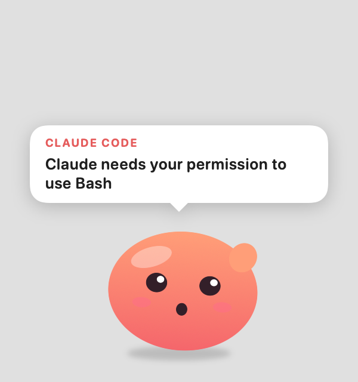
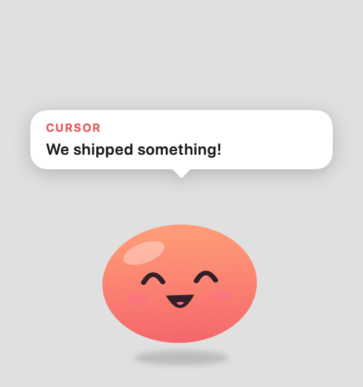

# Pip

A little mascot that lives in the corner of your Mac and reacts to your AI coding agent:
it peeks up while the agent works, waves when it needs your approval, and jumps with
confetti when the task is done.

| Working | Needs you | Done |
|---|---|---|
|  |  |  |

Works with **Claude Code** (CLI, the desktop app's Code tab, IDE extensions) and **Cursor**.
Free and open source. Pip is built from source on your Mac, so it needs no Apple signing.

## Install

You need macOS 13+ and Xcode Command Line Tools (`xcode-select --install`).

### Claude Code

```
/plugin marketplace add <github-user>/pip
/plugin install pip@pip
```

Pip builds itself in the background the first time a session starts (about 30 seconds).
To build it right away instead, run `plugin/scripts/install-app.sh`.

### Cursor

```bash
git clone https://github.com/<github-user>/pip && ./pip/cursor/setup-cursor.sh
```

Restart Cursor afterwards. Remove it with `./pip/cursor/setup-cursor.sh --uninstall`.

## Using it

- Pip lives in the menu bar (smiley icon): mute sounds, turn off peeking while working,
  try each animation, or quit.
- Click Pip to dismiss a bubble.

## How it works

```
Claude Code / Cursor hook ──curl──▶ 127.0.0.1:47823/event?state=done ──▶ Pip.app
```

| Event | Claude Code hook | Cursor hook |
|---|---|---|
| `working` | `UserPromptSubmit`, `PostToolUse` | `beforeSubmitPrompt` |
| `needs-input` | `Notification` (permission prompts, questions) | n/a |
| `done` | `Stop` | `stop` (`completed`; `error` shows a gentle message) |

Pip only listens on localhost. Anything else can drive it too:

```bash
curl -G 127.0.0.1:47823/event --data-urlencode state=done --data-urlencode "message=Tests passed!"
```

## Project layout

```
.claude-plugin/marketplace.json   this repo is its own plugin marketplace
plugin/
  .claude-plugin/plugin.json
  hooks/hooks.json                Claude Code hooks
  scripts/pip-event.sh            sends an event (never blocks the agent)
  scripts/ensure-app.sh           builds or launches Pip at session start
  scripts/install-app.sh          builds ~/Applications/Pip.app
  app/                            the Swift app (SwiftUI + AppKit)
cursor/setup-cursor.sh            adds the hooks to ~/.cursor/hooks.json
```

`~/Applications/Pip.app/Contents/MacOS/Pip --snapshot <dir>` renders each pose to a PNG.

## License

MIT
