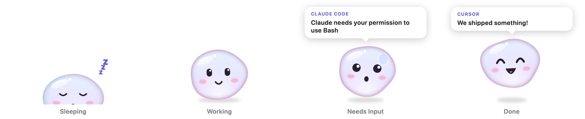

# pip-buddy

Meet **Pip**, a little liquid-glass blob that naps in the corner of your Mac and wakes up for your AI
coding agent: it looks around while the agent works, waves when it needs your approval,
and jumps with confetti when the task is done. Then it dozes off again.



Works with **Claude Code** (CLI, the desktop app's Code tab, IDE extensions) and **Cursor**.
Free and open source. Pip is built from source on your Mac, so it needs no Apple signing.

## Install

**Requirements:** macOS 13 or later, and Xcode Command Line Tools
(run `xcode-select --install` if you don't have them).

### Claude Code (CLI, desktop app Code tab, or IDE extension)

Run these inside Claude Code:

```
/plugin marketplace add Nish2097/pip-buddy
/plugin install pip@pip
```

Start a new session. The first time, Pip builds itself in the background
(about 30 seconds) and then appears in the bottom-right corner of your screen.

### Cursor

```bash
git clone https://github.com/Nish2097/pip-buddy.git
cd pip-buddy
./plugin/scripts/install-app.sh
./cursor/setup-cursor.sh
```

Restart Cursor.

### Uninstall

- Claude Code: `/plugin uninstall pip@pip`
- Cursor: `./cursor/setup-cursor.sh --uninstall`
- The app: quit Pip from the menu bar, then delete `~/Applications/Pip.app`

## Using it

- Pip lives in the menu bar (smiley icon): mute sounds, hide Pip while it sleeps,
  try each animation, or quit.
- Click Pip to dismiss a bubble and send it back to sleep.

## How it works

```
Claude Code / Cursor hook ──curl──▶ 127.0.0.1:47823/event?state=done ──▶ Pip.app
```

| Event | Claude Code hook | Cursor hook |
|---|---|---|
| `working` | `UserPromptSubmit`, `PostToolUse` | `beforeSubmitPrompt` |
| `needs-input` | `Notification` (permission prompts, questions) | n/a |
| `done` | `Stop` | `stop` (`completed`; `error` shows a gentle message) |

Pip only listens on localhost. Anything else can drive it too:

```bash
curl -G 127.0.0.1:47823/event --data-urlencode state=done --data-urlencode "message=Tests passed!"
```

## Project layout

```
.claude-plugin/marketplace.json   this repo is its own plugin marketplace
plugin/
  .claude-plugin/plugin.json
  hooks/hooks.json                Claude Code hooks
  scripts/pip-event.sh            sends an event (never blocks the agent)
  scripts/ensure-app.sh           builds or launches Pip at session start
  scripts/install-app.sh          builds ~/Applications/Pip.app
  app/                            the Swift app (SwiftUI + AppKit)
cursor/setup-cursor.sh            adds the hooks to ~/.cursor/hooks.json
```

`~/Applications/Pip.app/Contents/MacOS/Pip --snapshot <dir>` renders each pose to a PNG.

## License

[MIT](LICENSE)
